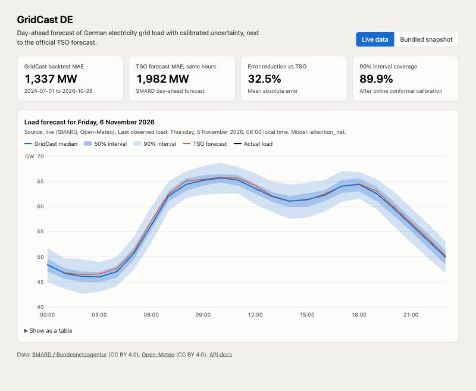
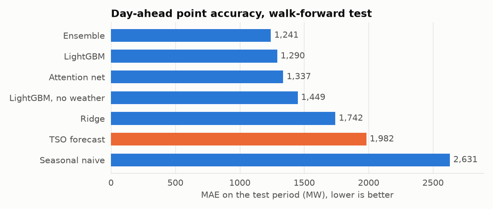
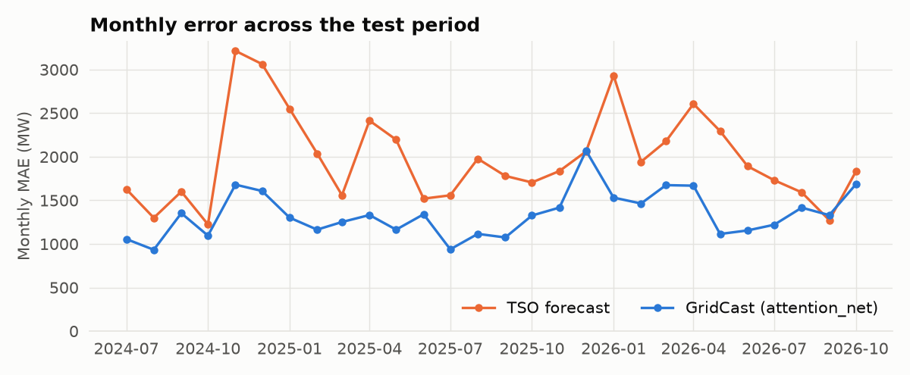
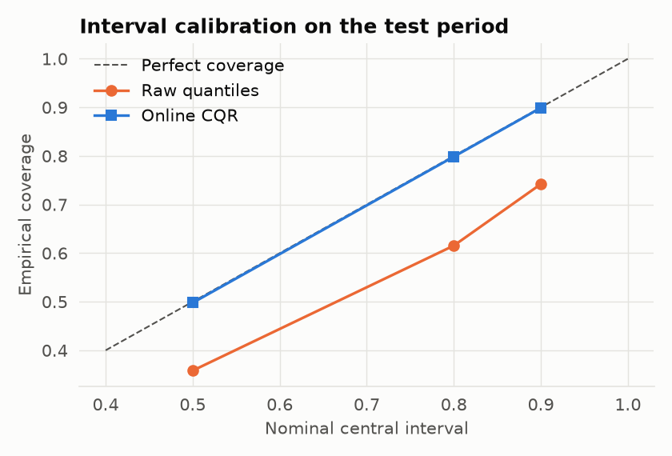
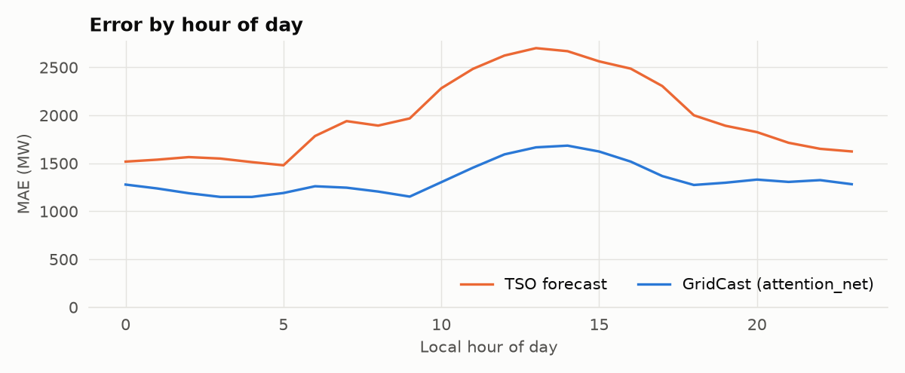
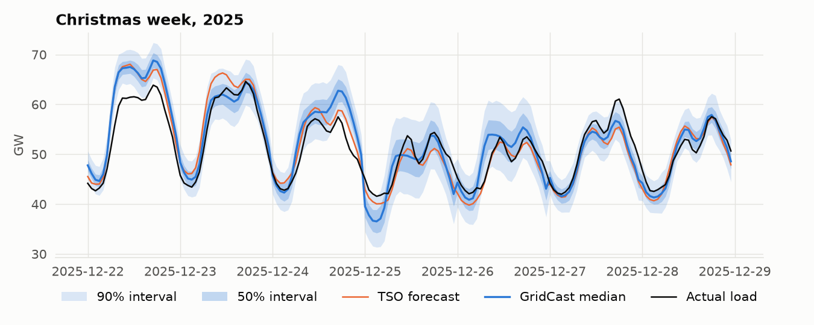
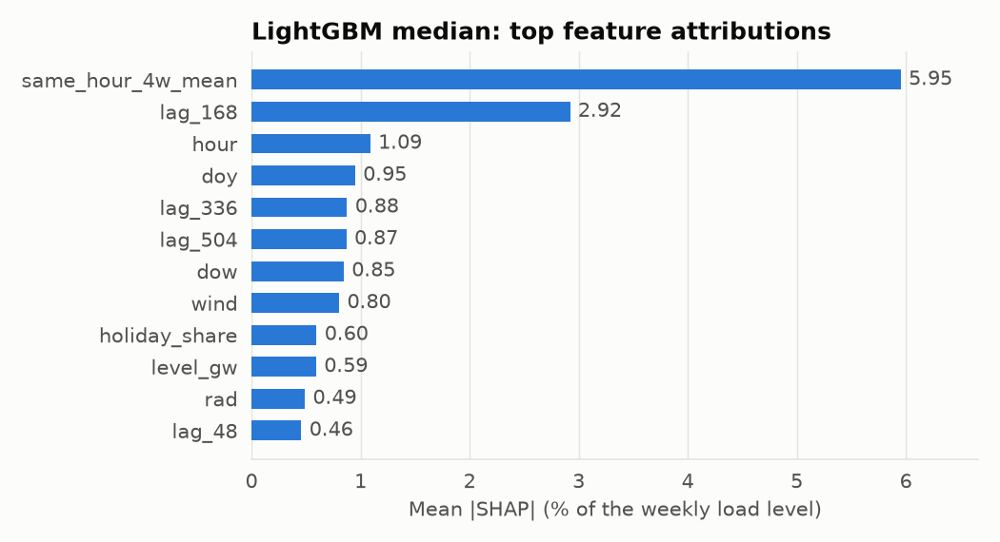
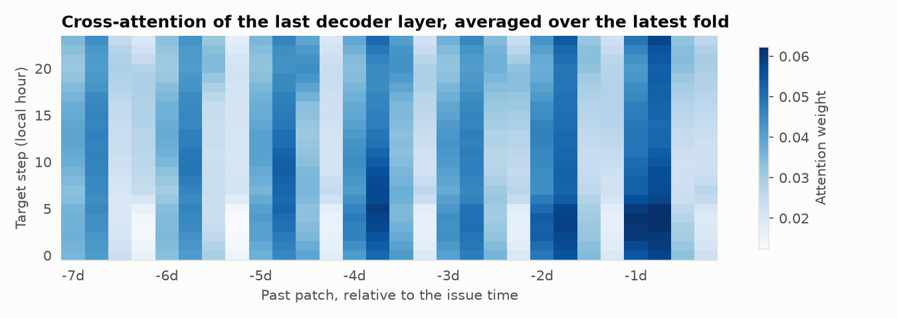
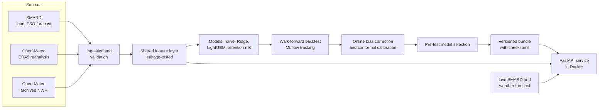

# GridCast DE

[](https://github.com/yousef-megeed/gridcast-de/actions/workflows/ci.yml)


**Probabilistic day-ahead forecasting of German electricity grid load, tested against the official forecast published by the grid operators.**

| Walk-forward test, 850 days (Jul 2024 – Oct 2026) | Deployed model | Official TSO forecast |
|---|---:|---:|
| Mean absolute error | **1,337 MW** (2.57%) | 1,982 MW (3.78%) |
| Error reduction | **32.5%** (Diebold-Mariano p < 0.001) | reference |
| 90% interval coverage | **89.9%**, after online conformal calibration | no intervals published |

Every test forecast uses only information available at issue time, including **archived weather forecasts rather than hindsight weather**. The deployed model was chosen on data from before the test period.



**Stack:** Python · PyTorch · LightGBM · scikit-learn · Optuna · MLflow · FastAPI · Docker · GitHub Actions · pytest

## Contents

- [The problem](#the-problem)
- [Results](#results)
- [How it works](#how-it-works)
- [Run it](#run-it)
- [API](#api)
- [Technical decisions](#technical-decisions)
- [Limitations](#limitations)
- [Repository layout](#repository-layout)
- [Data sources and licences](#data-sources-and-licences)

## The problem

Grid operators and energy traders commit to supply a day ahead, so forecast errors become balancing costs. Germany's transmission system operators (TSOs) publish a day-ahead load forecast, which gives this project a real-world benchmark rather than only a naive baseline.

**The forecasting task**

- **Issued:** 06:00 German time on day D-1, the last hour of observed load.
- **Target:** all 24 hours of day D, from local midnight, so lead times are 18 to 41 hours.
- **Output:** a median and three calibrated central intervals (50%, 80%, 90%).

## Results

Scored on all 20,400 hours from 1 July 2024 to 28 October 2026 in five half-yearly expanding folds. Skill is the MAE reduction relative to the TSO. Pinball loss scores the whole predicted distribution.

| Model | Weather at forecast time | MAE (MW) | RMSE (MW) | MAPE | Skill vs TSO | Pinball (MW) | 90% cov. (calibrated) |
|---|---|---:|---:|---:|---:|---:|---:|
| TSO day-ahead forecast (SMARD) | n/a | 1,982 | 2,552 | 3.78% | reference | n/a | n/a |
| Seasonal naive | none | 2,631 | 3,892 | 5.02% | -32.7% | 826 | 90.0% |
| Ridge | archived NWP | 1,742 | 2,333 | 3.35% | +12.1% | 520 | 89.8% |
| LightGBM, no weather | none | 1,449 | 1,877 | 2.75% | +26.9% | 454 | 90.1% |
| LightGBM | archived NWP | 1,290 | 1,665 | 2.46% | +34.9% | 427 | 89.9% |
| **Attention net (PyTorch), deployed** | archived NWP | **1,337** | **1,732** | **2.57%** | **+32.5%** | **408** | **89.9%** |
| Ensemble (LightGBM + attention) | archived NWP | 1,241 | 1,596 | 2.37% | +37.4% | 387 | 89.9% |
| LightGBM, oracle weather | hindsight ERA5 (upper bound) | 1,270 | 1,634 | 2.42% | +35.9% | 418 | 89.9% |

NWP = numerical weather prediction. The table is generated into [`results/model_comparison.md`](results/model_comparison.md), and all metrics are in [`results/metrics.json`](results/metrics.json).

**What this table shows**

- **The deployed model is not the best row, on purpose.** Selection used pinball loss on the 120 days before the test (attention net 367.4, ensemble 368.8, LightGBM 419.4). The ensemble later scored better on the test period, but choosing it because of that would be selection on test data, and its 37.4% would no longer be an unbiased estimate. It's reported as a tested alternative.
- **The improvement over the TSO is statistically significant.** For the deployed model, the Diebold-Mariano test on daily MAE with a Newey-West variance gives a statistic of -10.15 (p < 0.001). A 7-day block bootstrap puts the mean improvement at 526 to 777 MW (95% CI).
- **Weather forecasts add real value, and imperfect forecasts cost little.** For LightGBM, MAE goes from 1,449 MW with no weather to 1,290 MW with real archived forecasts and 1,270 MW with perfect hindsight weather.



### Results by fold

The advantage holds in every fold, but it isn't constant. The latest fold (under four months) has the smallest gap.

| Test period starts | Deployed MAE (MW) | TSO MAE (MW) | Reduction |
|---|---:|---:|---:|
| Jul 2024 | 1,285 | 2,001 | 35.8% |
| Jan 2025 | 1,260 | 2,047 | 38.5% |
| Jul 2025 | 1,324 | 1,820 | 27.2% |
| Jan 2026 | 1,435 | 2,314 | 38.0% |
| Jul 2026 | 1,407 | 1,604 | 12.3% |



### Uncertainty calibration

The network's raw 90% interval covered only 74.2% of hours, so it was overconfident. Online conformal calibration brought coverage to target across all levels (49.8%, 79.9%, 89.9%).

The cost is honesty about width: the mean 90% interval grew from 3.8 GW to 5.8 GW. The Winkler score, which rewards narrow intervals and penalises misses, still improved from 8,429 to 7,244, so the wider intervals are a net gain. The ensemble's interval is narrower at the same coverage (5.6 GW).



### Error analysis

| Segment | Hours | Deployed MAE (MW) | TSO MAE (MW) | Deployed mean error (MW) |
|---|---:|---:|---:|---:|
| Normal working day | 13,370 | 1,307 | 1,870 | +187 |
| Weekend | 5,350 | 1,220 | 2,100 | -411 |
| Regional holiday | 408 | 1,382 | 2,352 | +226 |
| Bridge day | 192 | 1,556 | 3,102 | +487 |
| National holiday | 552 | 2,117 | 2,162 | -666 |
| Christmas period | 528 | 2,356 | 2,749 | +1,469 |
| Temperature forecast error below 0.3 °C | 6,800 | 1,303 | 2,015 | +145 |
| Temperature forecast error of 0.7 °C or more | 6,801 | 1,375 | 1,955 | -95 |

**The main weakness is rare calendar days.** The advantage almost disappears on national holidays, and the Christmas period is badly over-forecast. There are only about 20 such days per year, which is little to learn from. In the worst days, GridCast lost to the TSO on German Unity Day 2026 (MAE 6,032 vs 4,628 MW) and on 29–31 December 2025.

The 10 worst days are in [`results/error_analysis.json`](results/error_analysis.json).





### Interpretability

**SHAP (LightGBM median, which is not the deployed model).** Same-hour load from recent weeks dominates (mean absolute contribution of 5.95% of the weekly level for the 4-week average, 2.92% for one week ago), followed by calendar features. Among weather inputs, wind (0.80%) and solar radiation (0.49%) reach the top 12. Temperature's effect is split across several related features, so its single-feature rank understates it. Wind's importance also fits the ERA5/NWP wind mismatch noted in [Limitations](#limitations) as a likely contributor to the forecast bias, though I haven't tested that directly.



**Attention (deployed network).** Attention concentrates on recent days, with a repeating daily pattern. It shows where the model looks, not why it decides, so I treat it as a sanity check rather than an explanation.



## How it works



### Data

103,840 hourly rows from January 2015. The load series had no gaps, duplicates or out-of-range values in this download, and the pipeline repairs and reports these if they appear. Weather is a population-weighted average of 9 metropolitan areas.

| Weather source | Used for | Why |
|---|---|---|
| ERA5 reanalysis | Training | Long, consistent history, but it uses hindsight |
| Archived NWP, predicted 48 h before valid time | Testing | Lead times here are at most 41 h, so these values existed at issue time |
| Live NWP forecast | Serving | What's actually available in production |

### Features and normalisation

German load has fallen from 58.1 GW in 2018 to 53.2 GW in 2025. Trees can't extrapolate below their training range, so **all load values are divided by the trailing weekly mean**, and models learn ratios.

Features include load at same-hour lags from 2 days to 4 weeks, recent level and trend, local-time calendar variables, population-weighted holiday share, bridge days, and weather. Temperature is also expressed relative to last week, because the weekly level already embeds last week's weather.

Training, backtesting and serving all share this code path, to prevent training/serving skew.

### Attention network

The deployed network is small: about 274,000 parameters and a 1.1 MB file.

1. **Encoder:** the past 7 days are split into 6-hour patches and passed through a Transformer encoder.
2. **Queries:** each target hour becomes a query built from what's known in advance about it, such as calendar, forecast weather and same-hour lags.
3. **Decoder:** queries use self-attention across target hours, then cross-attention over the past.
4. **Monotone head:** a median plus cumulative softplus increments, so quantiles **cannot cross by construction**:

   $$\hat q_{\tau_{k+1}} = \hat q_{\tau_k} + \mathrm{softplus}(z_k) + \epsilon$$

5. **Residual output:** the median predicts a correction to the mean of the four same-hour lags from the previous weeks.

Training minimises the pinball loss, whose minimiser is the true quantile:

$$L_\tau(y, \hat q) = \max\big(\tau (y - \hat q),\ (\tau - 1)(y - \hat q)\big)$$

### Calibration

Training on reanalysis and forecasting from NWP creates a covariate shift, and raw quantiles are overconfident. Two online corrections run at each issue time, using only outcomes that have resolved:

1. **Bias correction:** add the median error over the trailing 90 days.
2. **Conformalized quantile regression** (Romano et al., 2019), with one margin per lead:

   $$s_i = \max(\hat q_{\mathrm{lo}}(x_i) - y_i,\ y_i - \hat q_{\mathrm{hi}}(x_i))$$

3. **Adaptive conformal inference** (Gibbs & Candès, 2021) keeps long-run coverage under drift, where exchangeability fails:

   $$\alpha_{t+1} = \alpha_t + \gamma(\alpha - \mathrm{err}_t)$$

Long-run coverage close to nominal is partly what ACI enforces by design, so the Winkler score and interval width are the more informative measures.

### Evaluation design

| Stage | Data | Purpose |
|---|---|---|
| Tuning | Train to 2022, validate on 2023 | Optuna: 30 LightGBM trials, 15 network trials |
| Walk-forward | Five expanding folds from Jul 2024 | Early stop on the prior 182 days, refit on everything, forecast the fold |
| Selection | 120 days before the first test day | Choose the deployed model |

Tuning uses ERA5 because archived NWP is incomplete in 2023. The network uses three seeds per fold, averaged. The final model is trained with one seed on all data to 28 October 2026.

### Changes after the first evaluation

To keep the results honest, here's what I changed after seeing test scores. Both changes were justified by evidence outside the test scores, but I can't claim a fully untouched test set.

| Change | Evidence | LightGBM MAE |
|---|---|---:|
| First pass | n/a | 1,337 MW |
| Added online bias correction | A -430 MW bias existed before the test period, traced to the ERA5/NWP difference | 1,309 MW |
| Raised the boosting cap from 800 to 3,000 | Training logs showed early stopping hitting the cap in most folds | 1,290 MW |

An evaluation before the second change selected the ensemble. After it, the rule selected the attention net by 1.4 MW of pinball, and I kept that result. LightGBM's tails stay overconfident (raw 90% coverage of 64.9%), probably because it was tuned on the median only. I didn't retune after seeing test scores.

First-pass scores are kept in [`results/first_pass_metrics.json`](results/first_pass_metrics.json).

## Run it

### Docker

The fastest way to run the API and demo page:

```bash
docker compose up --build api
```

Then open <http://localhost:8000>. The image is 1.78 GB, including CPU-only PyTorch, runs as a non-root user and uses about 250 MB of memory when idle.

### Local setup

Requires Python 3.12 and [uv](https://docs.astral.sh/uv/). On macOS, LightGBM also needs `brew install libomp`.

```bash
make setup
```

```bash
make serve
```

### Reproduce the results

```bash
make reproduce
```

This downloads the data and runs tuning, the backtest, evaluation, packaging and figures. Each model trains in its own process. On a MacBook Air M5 with models sharing the CPU, the LightGBM backtests took about an hour each and the three-seed network backtest about 1.5 hours.

Individual steps are `make data`, `make tune`, `make backtest`, `make evaluate`, `make bundle` and `make analyze`. To browse experiments, run `make mlflow`.

### Quality checks

```bash
make test
```

```bash
make lint
```

75 tests need no network or downloaded data. They include:

- **Leakage:** corrupting all future load must not change features or network predictions.
- **Calendar:** issue times hold across both daylight-saving changes.
- **Calibration:** CQR repairs an overconfident model, ACI recovers after a shift, and feedback delays are respected.
- **Model properties:** quantiles cannot cross, and saved models reproduce their predictions.
- **Evaluation:** no look-ahead in calibration, plus an end-to-end backtest run.
- **API:** input validation, offline fallback, and refusing a tampered model bundle.

CI runs formatting, lint, type checks and tests, then builds the image and smoke-tests the real model through the API.

## API

Interactive docs are at `/docs`.

| Method | Path | Purpose |
|---|---|---|
| `GET` | `/` | Demo page |
| `GET` | `/health` | Liveness and readiness (503 when no model is loaded) |
| `GET` | `/metrics` | Prometheus metrics |
| `GET` | `/v1/model` | Model card: version, cut-off, scores, checksums |
| `GET` | `/v1/forecast/live` | Latest forecast from live public data, cached for 15 minutes |
| `GET` | `/v1/forecast/demo` | Forecast from bundled history; works offline |
| `POST` | `/v1/forecast` | Stateless forecast from your own history and weather |

```bash
curl http://localhost:8000/v1/forecast/demo
```

Abridged response:

```json
{
  "issue_time": "2026-10-27T05:00:00Z",
  "model_version": "1.0.0+<config hash>",
  "selected_model": "attention_net",
  "source": "bundled snapshot",
  "warnings": [],
  "points": [
    {
      "time": "2026-10-27T23:00:00Z",
      "median_mw": 45000.0,
      "intervals": {
        "0.90": { "lower_mw": 42000.0, "upper_mw": 48000.0 }
      },
      "quantiles_mw": { "0.50": 45000.0 },
      "tso_forecast_mw": 44000.0,
      "actual_mw": 44500.0
    }
  ]
}
```

The values in this example are illustrative, not model output.

### `POST /v1/forecast`

The last load point is the issue time, and the forecast covers the 24 hours starting 18 hours later. The request needs at least 673 consecutive hours of load, and hourly weather from before the model's context window through the end of the target.

```python
import httpx
import pandas as pd

history = pd.read_parquet("artifacts/model/demo_snapshot.parquet")
issue = len(history) - 42
payload = {
    "load": [
        {"time": t.isoformat(), "load_mw": float(v)}
        for t, v in history["load"].iloc[:issue].items()
    ],
    "weather": [
        {
            "time": t.isoformat(),
            "temperature_c": float(row.temp_nwp),
            "shortwave_radiation_wm2": float(row.rad_nwp),
            "wind_speed_kmh": float(row.wind_nwp),
        }
        for t, row in history.iloc[: issue + 41].iterrows()
    ],
}
response = httpx.post("http://localhost:8000/v1/forecast", json=payload, timeout=30)
print(response.json()["points"][0])
```

Invalid input returns HTTP 422 with a reason, such as a gap in the hourly series, a timezone-naive timestamp, too little history, or weather that doesn't reach the end of the target. Median latency measured against the container was 18 ms.

## Technical decisions

| Decision | Why | Alternative rejected |
|---|---|---|
| Benchmark against the TSO forecast | It's a real operational forecast, so the comparison means something | Only comparing against naive baselines |
| Test on archived NWP | Hindsight weather inflates results; here it would add about 20 MW of LightGBM skill | ERA5 for testing |
| Rolling-origin evaluation | Time series can't be shuffled without leaking the future | k-fold cross-validation |
| Normalise by trailing weekly mean | Handles the multi-year decline in load | Raw MW targets, which trees can't extrapolate |
| Monotone quantile head | Quantile crossing becomes impossible | Sorting outputs after training |
| Online conformal calibration | Coverage holds up under drift, and it wraps any model | Static calibration set |
| Fixed pre-test selection rule | Keeps the reported score unbiased | Deploying the test winner |
| Small network | Trains on a laptop CPU, under 25 minutes per fold with three seeds; tuning preferred it | Larger Transformer |
| Stateless API, no database | The forecast only needs its inputs; Redis or Postgres would add no value here | Storing inputs server-side |
| No Kubernetes | One stateless container meets the need | Orchestration for its own sake |

**A debugging note:** PyTorch and LightGBM ship separate OpenMP runtimes, which deadlocked at 0% CPU when training in one macOS process. Training now runs one model per process, and serving is single-threaded. A separate crash came from calling `reset_parameter` on a booster loaded from file, and a regression test now covers serving from a real LightGBM bundle.

## Limitations

- **Not run in production.** The backtest replays history. Results are not from a live system, and live forecasts haven't been scored over time.
- **Data vintages.** Training and evaluation use load as it's published today, so any later revisions are included. Real-time values could differ.
- **Publication times are assumed.** The 06:00 issue time leaves a margin before the TSO's stated deadline as I understand it, but I couldn't verify each forecast's exact publication time from SMARD.
- **Weather mismatch.** Trained on ERA5, with wind forecasts running about 2.3 km/h lower than reanalysis. Online bias correction reduces the effect but doesn't remove the cause.
- **Rare days.** Holidays and the Christmas period remain the weakest area.
- **Static calibration when serving.** The API uses margins frozen at packaging time. The backtest updates them daily, so a long-running deployment needs scheduled recalibration and retraining.
- **Backtest and deployed models differ slightly.** The 1,337 MW score averages three seeds per fold, while the deployed model is a single seed trained on all the data, so its accuracy could differ a little.
- **Test set was seen.** See [Changes after the first evaluation](#changes-after-the-first-evaluation).
- **Weather stations.** Nine weighted sites approximate national weather, rather than using gridded data or regional load.
- **Daylight saving.** The target is 24 steps from local midnight, so on the two yearly clock-change days it doesn't match the 23- or 25-hour local day exactly.
- **Licence.** Open-Meteo's free API is for non-commercial use, so commercial use needs a paid plan.

**Future work**

- Train on real NWP runs as more archive accumulates.
- Add features or a separate model for rare calendar days.
- Add school holidays and regional demand.
- Score live forecasts daily, and update calibration automatically.

## Repository layout

```text
├── artifacts/model/      Versioned deployment bundle with checksums
├── configs/              Experiment config and tuned hyperparameters
├── reports/figures/      Generated figures
├── results/              Metrics and error analysis
├── src/gridcast/
│   ├── data/             SMARD and Open-Meteo clients, validation
│   ├── models/           Baselines, LightGBM, attention network
│   ├── serve/            FastAPI app, schemas, inference, demo page
│   ├── features.py       Shared feature layer
│   ├── conformal.py      Bias correction, CQR, ACI
│   ├── metrics.py        Scores, Diebold-Mariano, block bootstrap
│   ├── backtest.py       Walk-forward engine with MLflow
│   ├── evaluate.py       Scoring and model selection
│   ├── tune.py           Optuna search on pre-test data
│   ├── analysis.py       Figures and error analysis
│   └── bundle.py         Final training and packaging
├── tests/                Offline test suite
├── Dockerfile
└── docker-compose.yml
```

## Data sources and licences

| Data | Source | Licence |
|---|---|---|
| Realised grid load, TSO day-ahead forecast | [SMARD](https://www.smard.de), Bundesnetzagentur | CC BY 4.0 |
| ERA5-based reanalysis, archived and live NWP | [Open-Meteo](https://open-meteo.com) | CC BY 4.0; free API for non-commercial use |

Raw data is not stored in this repository, and `make data` downloads it. The model bundle includes a small snapshot of recent data for the offline demo, with the same attribution.

The code is under the [MIT License](LICENSE).

## References

- Romano, Patterson & Candès (2019). *Conformalized Quantile Regression.* NeurIPS.
- Gibbs & Candès (2021). *Adaptive Conformal Inference Under Distribution Shift.* NeurIPS.
- Diebold & Mariano (1995). *Comparing Predictive Accuracy.* Journal of Business & Economic Statistics.
- Harvey, Leybourne & Newbold (1997). *Testing the Equality of Prediction Mean Squared Errors.* International Journal of Forecasting.
- Chernozhukov, Fernández-Val & Galichon (2010). *Quantile and Probability Curves Without Crossing.* Econometrica.
